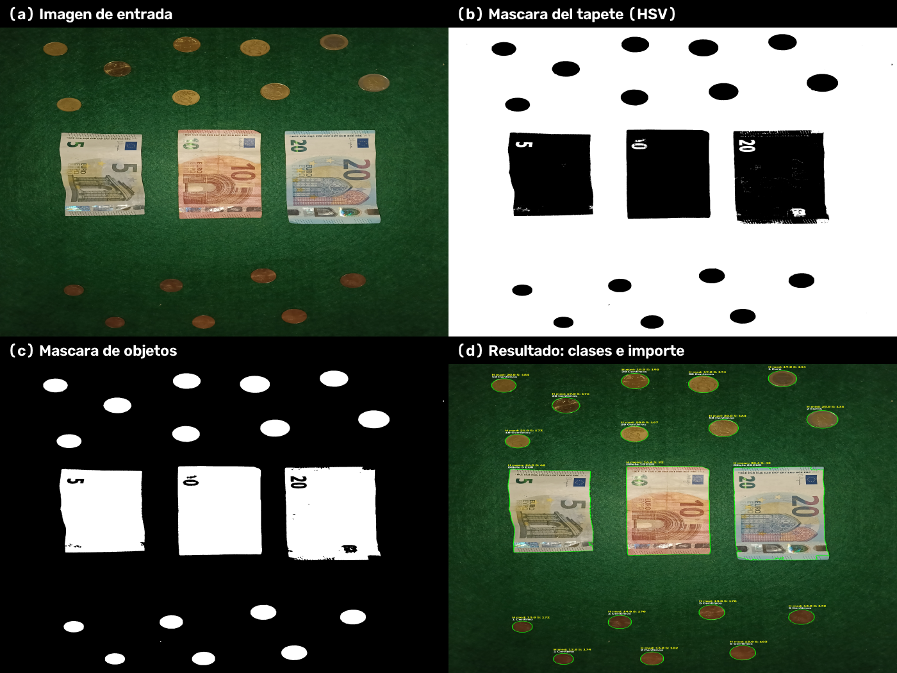
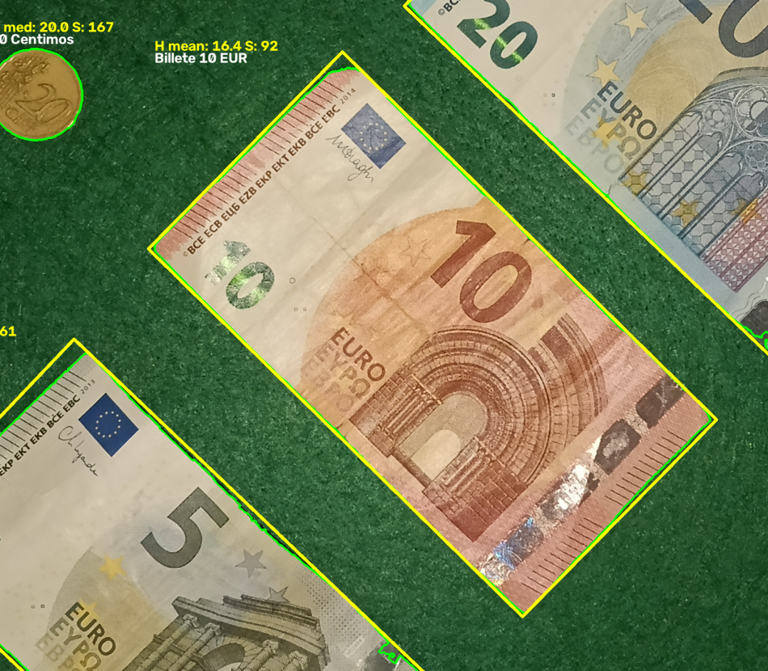
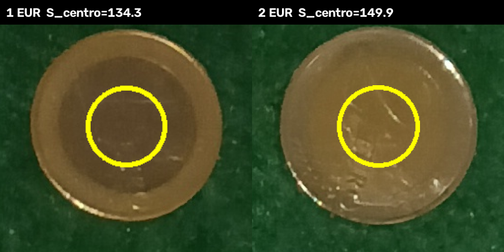

# Reto 07 — Monedas y billetes

## Sistema experto de visión artificial clásica para la identificación de monedas y billetes y el cálculo del importe total

**Asignatura:** Inteligencia Artificial — Examen parcial  
**Autor:** Martín López de Novales Gurruchaga   
**Vídeo de la demo:** [enlace de YouTube]  
**Código fuente:** `2_main.py` (programa final), `1-calibrar.py` y `calibrar_tapete.py` (herramientas de calibración)

---

## Resumen

Este trabajo presenta un sistema de visión artificial clásica que analiza una escena cenital formada por monedas y billetes de euro colocados sobre un tapete verde mate, identifica la denominación de cada elemento y calcula el importe monetario total.

---

## Índice

1. Contextualización del problema y requisitos
2. Montaje físico, cámara, tapete e iluminación
3. Diagrama del pipeline completo
4. Método de segmentación
5. Tabla de características extraídas
6. Árbol de decisión
7. Justificación experimental de parámetros y umbrales
8. Resultados sobre el conjunto de pruebas *(pendiente)*
9. Medida cuantitativa de aciertos y errores *(pendiente)*
10. Código del programa funcional

---

## 1. Contextualización del problema y requisitos

Contar y valorar dinero en efectivo es una tarea repetitiva, propensa a errores y todavía frecuente en comercio minorista, banca, máquinas de *vending* y procesos de auditoría. Un sistema de visión puede automatizarla si es capaz de responder tres preguntas encadenadas:

1. **¿Cuántos objetos hay y dónde están?** (detección)
2. **¿Qué es cada objeto?** (identificación de la denominación)
3. **¿Cuánto dinero hay en total?** (interpretación de la escena)

La escena que se aborda es una fotografía cenital de un tapete verde mate sobre el que se distribuyen monedas y billetes de euro en posiciones y orientaciones arbitrarias. El reto consiste en explotar propiedades visuales como la forma, tamaño, color y estructura interna.

El sistema identifica las siguientes clases de objetos:

- **Monedas (8 clases):**
  - cobre: 1, 2 y 5 céntimos;
  - oro nórdico: 10, 20 y 50 céntimos;
  - bimetaladas: 1 € y 2 €.
- **Billetes (3 clases):** 5, 10 y 20 €.

El sistema trabaja **sobre una fotografía**, no sobre un flujo de vídeo. Esto es porque elimina la variabilidad temporal (desenfoque de movimiento, cambios de exposición entre fotogramas) que complicaría la justificación de los umbrales.

**Objetivos funcionales:**

- **O1 — Detección:** localizar todos los objetos presentes, sin omisiones ni detecciones espurias.
- **O2 — Identificación:** asignar a cada contorno una de las 11 denominaciones, o la etiqueta `Desconocido`.
- **O3 — Interpretación:** calcular el importe total en euros.
- **O4 — Rechazo controlado:** un objeto no monetario no debe romper el total; se etiqueta como desconocido y aporta 0 €.

**Criterios de éxito**

- el importe total es correcto cuando todos los objetos se segmentan y clasifican correctamente;
- la clasificación por objeto se evalúa de forma independiente del total, para no ocultar errores compensados (por ejemplo, un 2 € confundido con dos monedas de 1 €);
- el sistema no debe depender de que los objetos estén en posiciones concretas ni de una orientación fija.

**Supuestos de trabajo:**

- Iluminación suficientemente uniforme y difusa; sin sombras duras ni reflejos especulares dominantes.
- El tapete es completamente visible en la imagen y su color no se confunde con el de los objetos.
- Los objetos están separados entre sí (no se tocan ni se solapan).
- La cámara mantiene la misma altura y orientación durante una sesión, de modo que la escala en píxeles por milímetro es constante.
- Los billetes deben de ir en la zona centrica del tapete y las monedas en el exterior debido al reflejo de las monedas con la iluminación.
- Los objetos no pueden estar cortados por el encuadre de la imagen.

---

## 2. Montaje físico, cámara, tapete e iluminación

Para tener un entorno perfectamente replicable he decidido que el montaje consista en un tapete verde mate de 60x40 (centímetros) y una caja de cartón de 60x40x40 (centímetros). La cara inferior de la caja se ha extraido para poder levantarla facilmente y poder manipular los objetos del tapete (que se encuentra en el inferior). La cara superior de la caja tiene un agujero que se hizo a mano para poder fotografiar el interior con la cámara.

La cámara que se utiliza es la de el teléfono movil Oppo A6 Pro. Esta cámara saca fotos a 4096 x 3072 píxeles a 12 megapíxeles. Otras carácteristicas son ISO 400, 1/50s de velocidad de obturación, f 1,8 de apertura de diafragma y 27mm de distancia focal.

Para la iluminación utilizo el LED flash de la cámara del teléfono móvil previamente mencionado.

---

## 3. Diagrama del pipeline completo

### 3.1. Diagrama

**Figura 1. Pipeline de visión artificial clásica implementado.**

```text
┌───────────────────────────────────────────────────────────────────────────┐
│ 1. ADQUISICIÓN                                                            │
│    Fotografía cenital 4096 × 3072 px (12,6 Mpx), JPEG                     │
│    Lectura tolerante a rutas no ASCII: cv2.imdecode + np.fromfile         │
└──────────────────────────────────┬────────────────────────────────────────┘
                                   ▼
┌───────────────────────────────────────────────────────────────────────────┐
│ 2. PREPROCESAMIENTO                                                       │
│    BGR → HSV:  cv2.cvtColor(frame, cv2.COLOR_BGR2HSV)                     │
└──────────────────────────────────┬────────────────────────────────────────┘
                                   ▼
┌───────────────────────────────────────────────────────────────────────────┐
│ 3. SEGMENTACIÓN                                                           │
│    Máscara del tapete:  cv2.inRange(hsv, VERDE_BAJO, VERDE_ALTO)          │
│    Máscara de objetos:  cv2.bitwise_not(máscara del tapete)               │
│    Limpieza:            open(5×5) → close(5×5), elemento elíptico         │
└──────────────────────────────────┬────────────────────────────────────────┘
                                   ▼
┌───────────────────────────────────────────────────────────────────────────┐
│ 4. DETECCIÓN DE OBJETOS                                                   │
│    cv2.findContours(RETR_EXTERNAL, CHAIN_APPROX_SIMPLE)                   │
│    Filtros: área ≥ 2000 px²  y  contorno que no toca el borde             │
└──────────────────────────────────┬────────────────────────────────────────┘
                                   ▼
┌───────────────────────────────────────────────────────────────────────────┐
│ 5. EXTRACCIÓN DE CARACTERÍSTICAS                                          │
│    Geométricas: A, P, C, AR, radio equivalente r                          │
│    Color: H mediano, H/S/V medios, b de Lab, saturación del disco central │
└──────────────────────────────────┬────────────────────────────────────────┘
                                   ▼
┌───────────────────────────────────────────────────────────────────────────┐
│ 6. CLASIFICACIÓN — ÁRBOL DE DECISIÓN                                      │
│    ¿Billete? ──► prototipos de color ──► 5 / 10 / 20 €                    │
│    ¿Moneda?  ──► ¿bimetal? ──► 1 € / 2 €                                  │
│              └─► ¿cobre?   ──► radio ──► 1 / 2 / 5 c                     │
│                  ¿oro nórdico? ──► radio ──► 10 / 20 / 50 c               │
└──────────────────────────────────┬────────────────────────────────────────┘
                                   ▼
┌───────────────────────────────────────────────────────────────────────────┐
│ 7. INTERPRETACIÓN DE LA ESCENA                                            │
│    Suma de valores + resumen por objeto + imagen anotada guardada         │
└───────────────────────────────────────────────────────────────────────────┘
```

---

## 4. Método de segmentación

La segmentación responde a una única pregunta: ¿qué píxeles son tapete? Todo lo que no lo sea se considera un objeto. El enfoque invierte el problema habitual: en lugar de describir cada tipo de moneda o billete, se describe el fondo, que es una sola clase, ocupa la mayor parte de la imagen y cambia poco entre escenas.

### Por qué se usa HSV

En RGB, un cambio de luz o una sombra modifica los tres canales a la vez. En HSV, el tono (H) se mantiene aunque cambie el brillo (V), y la saturación (S) indica cuán «puro» es el color. Eso permite definir el tapete por su tono verde y admitir a la vez zonas iluminadas y en sombra. Los metales de las monedas y la tinta de los billetes tienen poca saturación o un tono fuera del verde, por lo que quedan al otro lado de la frontera.

### Máscara del tapete

Se marca como tapete todo píxel cuyos H, S y V caigan en estos rangos:

```python
VERDE_BAJO = np.array([35, 40, 25])
VERDE_ALTO = np.array([85, 255, 255])
mask_tapete = cv2.inRange(hsv, VERDE_BAJO, VERDE_ALTO)
```

El rango de H (35–85) es más amplio que el verde medido del tapete (≈ 58–65) para incluir bordes y transiciones; S y V se dejan abiertos para no perder el tapete en sombra. Los valores se obtuvieron con `calibrar_tapete.py` y se contrastaron en el apartado 7.2.

### Limpieza de la máscara

La máscara de objetos es el negativo de la del tapete. Contiene motas sueltas por ruido JPEG y pequeños huecos por reflejos, así que se aplican dos operaciones:

- **apertura:** elimina las motas pequeñas;
- **cierre:** rellena huecos y suaviza el borde.

### De la máscara a los objetos

Se buscan los contornos externos de la máscara. Se usa el contorno exterior (no los internos) para que un hueco dentro de un billete no se trate como un objeto aparte. Después se descartan:

- las regiones de menos de 2000 px² (la moneda más pequeña tiene ≈ 14 700 px²);
- las regiones que tocan el borde de la imagen, porque están cortadas y no se pueden medir bien.

Cada contorno que supera los filtros es un objeto candidato.

### Cómo se mide el color de cada objeto

El color no se promedia sobre el rectángulo que envuelve al objeto, porque ese rectángulo incluye tapete y desplazaría la medida hacia el verde. Se usa una máscara con la forma exacta del contorno, de modo que solo se promedian los píxeles del objeto.

- En las **monedas** se usa el tono mediano, calculado solo con píxeles suficientemente saturados (S ≥ 100). La mediana aguanta mejor los reflejos que la media, y descartar los píxeles grises evita tonos inestables.
- En los **billetes** se usan el tono medio, la saturación media y el canal *b* de Lab, que describen la paleta del billete.

### Resultado

La siguiente figura muestra las cuatro etapas. La máscara es limpia y conserva la forma de monedas y billetes. En los billetes aparecen pequeños huecos donde el papel brillante refleja el verde del tapete; no afectan al resultado porque el objeto se detecta por su contorno exterior y las medidas de color se calculan sobre el contorno relleno.

**Segmentación y resultado sobre la escena `IMG20261019113420.jpg`: (a) imagen de entrada; (b) máscara del tapete; (c) máscara de objetos tras la limpieza morfológica; (d) imagen final anotada.**



---

## 5. Tabla de características extraídas

La tabla recoge todas las características que calcula el programa, su definición y el uso que reciben en el árbol de decisión.

**Características extraídas, cálculo y uso.**

| # | Característica | Símbolo | Cómo se calcula | Uso |
|---|---|---|---|---|
| 1 | Área | $A$ | `cv2.contourArea(cnt)` (fórmula del polígono) | Filtro de ruido y separación billete/moneda |
| 2 | Perímetro | $P$ | `cv2.arcLength(cnt, True)` | Base de la circularidad |
| 3 | Circularidad | $C$ | $C = \dfrac{4\pi A}{P^2}$ | Separar monedas de billetes |
| 4 | Rectángulo envolvente | $(x,y,w,h)$ | `cv2.boundingRect(cnt)` | Delimitar la ROI y anotar |
| 5 | Relación de aspecto orientada | $AR$ | Cociente entre el lado mayor y el menor del rectángulo mínimo orientado (`cv2.minAreaRect`) | Rama de billetes |
| 6 | Radio equivalente | $r$ | $r = \sqrt{A/\pi}$ | Denominación de monedas |
| 7 | Hue mediano | $\tilde{H}$ | Mediana de $H$ con $S \ge 100$ | Cobre frente a oro nórdico |
| 8 | Hue medio | $\bar{H}$ | Media de $H$ en el contorno relleno | Prototipos de billetes |
| 9 | Saturación media | $\bar{S}$ | Media de $S$ en el contorno relleno | Detección de bimetaladas |
| 10 | Valor medio | $\bar{V}$ | Media de $V$ en el contorno relleno | Diagnóstico y calibración (no decide) |
| 11 | Canal *b* de Lab | $\bar{b}$ | Media de $b_{\text{Lab}}$ en el contorno relleno | Prototipos de billetes |
| 12 | Saturación central | $S_c$ | Media de $S$ en un disco de radio $0{,}4\,r$ centrado en el objeto | Distinguir 1 € de 2 € |
| 13 | Posición | $(x,y)$ | Origen del rectángulo envolvente | Anotación de la imagen; no clasifica |

---

## 6. Árbol de decisión

```text
Contorno candidato (A ≥ 2000 px² y no toca el borde de la imagen)
│
├─ AR > 1,40  ∧  A > 100 000 px² ────────────────────────────────► BILLETE
│      │  medir H̄, S̄ y b̄(Lab)
│      └─ clase = argmin_k d_k  ──► 5 €  |  10 €  |  20 €
│
├─ C > 0,75  (si no es billete) ─────────────────────────────────► MONEDA
│      │
│      ├─ S̄ < 150 ──► BIMETALADA
│      │      ├─ S_c > 145 ──► 2 €
│      │      └─ S_c ≤ 145 ──► 1 €
│      │
│      └─ S̄ ≥ 150 ──► MONOMETÁLICA
│             ├─ H̃ < 16,5 ──► COBRE
│             │      ├─ r < 75 px ──► 1 c
│             │      ├─ r < 85 px ──► 2 c
│             │      └─ r ≥ 85 px ──► 5 c
│             │
│             └─ H̃ ≥ 16,5 ──► ORO NÓRDICO
│                    ├─ r < 89 px ──► 10 c
│                    ├─ r < 99 px ──► 20 c
│                    └─ r ≥ 99 px ──► 50 c
│
└─ cualquier otro caso ──────────────────────────────────────────► DESCONOCIDO (0 €)
```

**Nodos del árbol de decisión.**

| Nodo | Pregunta | Característica | Umbral | Rama verdadera | Rama falsa |
|---|---|---|---|---|---|
| N0 | ¿Es un objeto medible? | $A$ y borde | $A \ge 2000$ px² y sin tocar borde | Candidato | Descartado |
| N1 | ¿Es un billete? | $AR$, $A$ | $AR > 1{,}40 \land A>10^5$ | Billete (N8) | N2 |
| N2 | ¿Es una moneda? | $C$ | $C > 0{,}75$ | Moneda (N3) | Desconocido |
| N3 | ¿Es bimetalada? | $\bar{S}$ | $\bar{S} < 150$ | N4 | N5 |
| N4 | ¿1 € o 2 €? | $S_c$ | $S_c > 145$ | 2 € | 1 € |
| N5 | ¿Es de cobre? | $\tilde{H}$ | $\tilde{H} < 16{,}5$ | N6 | N7 |
| N6 | ¿Qué valor de cobre? | $r$ | 75 px, 85 px | 1 c / 2 c / 5 c | — |
| N7 | ¿Qué valor de oro nórdico? | $r$ | 89 px, 99 px | 10 c / 20 c / 50 c | — |
| N8 | ¿Qué billete? | $\bar{H}, \bar{S}, \bar{b}$ | mínima distancia a prototipos | 5 / 10 / 20 € | — |

La condición del nodo N1 se evalúa sobre el **rectángulo mínimo orientado** que devuelve `cv2.minAreaRect`, no sobre el rectángulo paralelo a los ejes. Sus dos lados son el largo y el ancho reales del billete, de modo que la relación de aspecto no cambia al girarlo: un billete a 45° sigue dando ≈ 1,8. El umbral 1,40 es el punto medio entre las monedas (1,000–1,032) y los billetes (1,778–1,897), con un margen de ±0,37.

La siguiente figura muestra un billete de 10 € girado 45°: el contorno verde es el detectado y el rectángulo amarillo es el mínimo orientado que se usa para medir la relación de aspecto. El sistema lo identifica igual que si estuviera recto.

**Billete de 10 € girado 45° sobre la escena `IMG20261019113420.jpg`; el rectángulo mínimo orientado conserva la relación de aspecto.**



**Rama de billetes: clasificación por prototipos**

Los billetes no se separan con umbrales independientes porque sus rangos de color se solapan parcialmente. En su lugar se definieron tres prototipos a partir de la calibración y se asigna la clase cuya distancia normalizada es menor.

La siguiente figura ilustra el fundamento del nodo N4 sobre dos monedas reales: el disco amarillo representa la región central del 40 % del radio sobre la que se mide la saturación. En el 1 € el centro es plateado (S = 134,3) y en el 2 € es dorado (S = 149,9); el umbral 145 queda entre ambos.

**Región central utilizada para distinguir 1 € de 2 € sobre las monedas de la escena `IMG20261019105013.jpg`.**



---

## 7. Justificación experimental de parámetros y umbrales

Este apartado documenta **de dónde sale cada número** del programa. No se presentan umbrales «elegidos a ojo»: para cada uno se indica el intervalo medido de las clases que separa, el punto de corte adoptado y el margen que queda a cada lado.

### Metodología de calibración

La calibración se realizó en tres pasos con las dos herramientas auxiliares:

1. **Calibración del fondo (`calibrar_tapete.py`).** Se selecciona una fotografía que contenga solo el tapete. El programa calcula los percentiles 1 y 99 de H, S y V, les suma un margen (±3 para H, ±15 para S y V) y propone un rango HSV, que se muestra como vista previa junto a la imagen original. Así se obtiene el color real del tapete en las condiciones de iluminación del montaje.
2. **Medición de objetos (`1-calibrar.py`).** Se selecciona una escena, el programa segmenta y detecta los objetos y, al hacer clic sobre cada uno, imprime en consola su área, su rectángulo envolvente, su relación de aspecto, su circularidad, su tono medio y mediano, y —según el tipo— la saturación del centro o los valores Lab. Al salir, guarda todas las medidas en `calibracion.json`.
3. **Fijación de umbrales.** Con varias medidas por clase se identifican los huecos entre clases adyacentes y se sitúa el umbral en el punto medio, dejando un margen simétrico. Cuando el margen resultaba asimétrico se desplazaba el corte hacia la clase con mayor variabilidad.

Las cifras que se presentan a continuación se obtuvieron ejecutando el **extractor de características** sobre las cuatro escenas con objetos y agrupando los resultados por clase.

**Imágenes utilizadas para la calibración.**

| Imagen | Resolución | Monedas | Billetes | Objetos | Uso |
|---|---|---|---|---|---|
| `IMG20261019094418.jpg` | 4096 × 3072 | 7 | 2 (10, 20 €) | 9 | Escena |
| `IMG20261019095027.jpg` | 4096 × 3072 | 16 | 2 (10, 20 €) | 18 | Escena |
| `IMG20261019105013.jpg` | 4096 × 3072 | 16 | 2 (10, 20 €) | 18 | Escena |
| `IMG20261019113420.jpg` | 4096 × 3072 | 16 | 3 (5, 10, 20 €) | 19 | Escena |
| `IMG20261019102809.jpg` | 3072 × 4096 | — | — | 0 | Solo tapete |
| `IMG20261019103327.jpg` | 3072 × 4096 | — | — | 0 | Solo tapete |
| **Total** | — | **55** | **9** | **64** | — |

### Calibración del tapete

La siguiente table resume los valores medidos sobre las dos imágenes que contienen únicamente tapete.

**Distribución del color del tapete en HSV**

| Canal | Mínimo | Percentil 1 | Mediana | Percentil 99 | Máximo |
|---|---|---|---|---|---|
| H | 21 | 57 | 62 | 65 | 78 |
| S | 27 | 73 | 132 | 177 | 255 |
| V | 51 | 102 | 146 | 235 | 255 |

Con los percentiles y los márgenes del script se obtienen rangos del orden de **[54, 58, 87] – [68, 192, 250]**. Ese rango estrecho cubre el **99,5 %** de los píxeles del tapete: el 0,5 % restante corresponde a sombras profundas y a bordes, y al invertir la máscara podía convertirse en falsos objetos. Por eso el programa final adopta el rango más amplio **[35, 40, 25] – [85, 255, 255]**, que cubre el **100,00 %** de los píxeles del tapete en ambas imágenes.

### Medidas de las monedas

La siguiente tabla recoge, por denominación, el número de instancias medidas y el rango de cada característica.

**Características medidas en las 55 monedas (rango mínimo–máximo).**

| Clase | n | $r$ (px) | $\tilde{H}$ | $\bar{S}$ | $C$ | $A$ (px²) |
|---|---|---|---|---|---|---|
| 1 c | 8 | 68,46 – 69,87 | 12 – 15 | 158,3 – 183,9 | 0,816 – 0,894 | 14 724 – 15 337 |
| 2 c | 4 | 80,14 – 81,10 | 13 – 15 | 165,7 – 182,5 | 0,865 – 0,875 | 20 176 – 20 665 |
| 5 c | 16 | 88,82 – 90,75 | 13 – 14 | 164,3 – 183,6 | 0,861 – 0,887 | 24 786 – 25 872 |
| 10 c | 6 | 82,99 – 84,37 | 20 – 21 | 167,8 – 183,8 | 0,865 – 0,880 | 21 637 – 22 362 |
| 20 c | 9 | 92,60 – 95,13 | 18 – 21 | 157,8 – 190,7 | 0,867 – 0,889 | 26 939 – 28 432 |
| 50 c | 6 | 102,09 – 103,10 | 19 – 21 | 161,7 – 176,8 | 0,869 – 0,890 | 32 744 – 33 395 |
| 1 € | 3 | 97,55 – 98,01 | 18 – 19 | 142,4 – 144,1 | 0,868 – 0,882 | 29 896 – 30 178 |
| 2 € | 3 | 107,81 – 108,69 | 19 – 20 | 133,2 – 143,3 | 0,863 – 0,879 | 36 516 – 37 110 |

Se observan tres hechos que sostienen el árbol:

- **El radio ordena las denominaciones dentro de cada familia**, pero no entre familias.
- **El tono separa limpiamente el cobre del oro nórdico.**
- **La saturación separa las bimetaladas.**

**Validación física de la escala y de los umbrales de radio.** Si el radio medido es proporcional al diámetro real, la relación $2r / \varnothing_{\text{nominal}}$ debe ser la misma para todas las monedas. La siguiente tabla lo comprueba con los diámetros normalizados del euro.

**Contraste del radio medido con el diámetro nominal (escala de la escena).**

| Clase | $\varnothing$ nominal (mm) | $r$ medio (px) | $\varnothing$ medido (px) | Escala (px/mm) |
|---|---|---|---|---|
| 1 c | 16,25 | 69,00 | 138,00 | 8,49 |
| 2 c | 18,75 | 80,62 | 161,24 | 8,60 |
| 5 c | 21,25 | 89,76 | 179,52 | 8,45 |
| 10 c | 19,75 | 83,58 | 167,16 | 8,46 |
| 20 c | 22,25 | 94,48 | 188,96 | 8,49 |
| 50 c | 24,25 | 102,61 | 205,22 | 8,46 |
| 1 € | 23,25 | 97,73 | 195,46 | 8,41 |
| 2 € | 25,75 | 108,15 | 216,30 | 8,40 |

La escala resultante es **8,47 px/mm** (≈ 0,118 mm/px), con un rango de 8,40 a 8,60 px/mm, es decir, una dispersión máxima del 1,5 %. Esta consistencia valida tres cosas a la vez: que todas las monedas están en el mismo plano, que el radio equivalente es una medida fiable del tamaño y que los umbrales en píxeles tienen sentido físico. La siguiente tabla traduce cada umbral de radio a milímetros y lo sitúa frente a los diámetros que separa.

**Umbrales de radio y su equivalente físico.**

| Umbral | Equivalente en diámetro | Monedas que separa (diámetro nominal) |
|---|---|---|
| 75 px | 17,7 mm | 1 c (16,25 mm) / 2 c (18,75 mm) |
| 85 px | 20,1 mm | 2 c (18,75 mm) / 5 c (21,25 mm) |
| 89 px | 21,0 mm | 10 c (19,75 mm) / 20 c (22,25 mm) |
| 99 px | 23,4 mm | 20 c (22,25 mm) / 50 c (24,25 mm) |

Los cuatro cortes caen dentro del hueco real entre diámetros, no en el borde de una clase. El margen más ajustado es el de 20 c / 50 c (3,1 px, ≈ 3 % del radio), todavía superior a la dispersión entre imágenes (≤ 1,5 %), de modo que la separación es estable aunque no holgada.

### Medidas de los billetes

**Características medidas en los 9 billetes.**

| Clase | n | $\bar{H}$ | $\bar{S}$ | $\bar{b}$ | $A$ (px²) | $AR$ | $d_1$ | $d_2$ |
|---|---|---|---|---|---|---|---|---|
| 5 € | 1 | 26,49 | 61,67 | 142,7 | 543 754 | 1,785 | 0,0002 | 0,1029 |
| 10 € | 4 | 16,41 – 18,82 | 92,4 – 99,0 | 149,8 – 150,9 | 607 753 – 622 384 | 1,890 – 1,897 | 0,0001 – 0,0268 | 0,1358 – 0,1583 |
| 20 € | 4 | 37,03 – 40,34 | 38,2 – 42,4 | 135,9 – 137,2 | 681 388 – 688 806 | 1,778 – 1,801 | 0,0001 – 0,0202 | 0,1029 – 0,1229 |

$AR$ se mide sobre el rectángulo mínimo orientado (`cv2.minAreaRect`), por lo que es siempre mayor que 1 y no depende del giro del billete.

$d_1$ es la distancia al prototipo de su propia clase y $d_2$ la distancia al prototipo de la clase más próxima. Los tres prototipos se midieron sobre la imagen `IMG20261019113420.jpg`; las otras tres escenas permiten comprobar la generalización de los prototipos de 10 € y 20 €. En ellas, $d_1$ nunca supera 0,027 y $d_2$ nunca baja de 0,103: la frontera de decisión queda a más de 3,8 veces la distancia al prototipo correcto. Esa es la justificación experimental de usar distancias en lugar de umbrales rígidos.

### Resumen de umbrales y márgenes

La tabla reúne todos los cortes del árbol con el margen medido a cada lado.

**Umbrales, separación experimental y margen.**

| Umbral | Valor | Separación medida | Margen |
|---|---|---|---|
| Área mínima de objeto | 2000 px² | objeto menor: 14 724 px² | 7,4 × |
| Área de billete | 100 000 px² | moneda mayor 37 110 / billete menor 543 754 | 2,7 × / 5,4 × |
| Relación de aspecto orientada | 1,40 | monedas 1,000–1,032; billetes 1,778–1,897 | 0,37 / 0,38 |
| Circularidad | 0,75 | monedas ≥ 0,816; billetes ≤ 0,700 | 0,066 / 0,050 |
| $\tilde{H}$ cobre/oro | 16,5 | cobre ≤ 15; oro ≥ 18 | 1,5 / 1,5 |
| $\bar{S}$ bimetal | 150 | bimetal ≤ 144,1; resto ≥ 157,8 | 5,9 / 7,8 |
| $S_c$ 1 €/2 € | 145 | 1 € ≤ 136,0; 2 € ≥ 149,9 | 9,0 / 4,9 |
| $r$ 1 c / 2 c | 75 px | 69,9 / 80,1 px | 5,1 / 5,1 px |
| $r$ 2 c / 5 c | 85 px | 81,1 / 88,8 px | 3,9 / 3,8 px |
| $r$ 10 c / 20 c | 89 px | 84,4 / 92,6 px | 4,6 / 3,6 px |
| $r$ 20 c / 50 c | 99 px | 95,1 / 102,1 px | 3,9 / 3,1 px |
| Distancia a prototipo | — | $d_1 \le 0{,}027$; $d_2 \ge 0{,}103$ | 3,8 × |

Todos los cortes son **puntos medios** de los huecos medidos, salvo dos:

- el umbral de saturación central (145) se desplazó hacia arriba desde el punto medio (142,9) para dar más margen al 1 €, que presenta mayor variabilidad por reflejos en el centro plateado;
- el umbral de área de billete (100 000 px²) no es crítico y se fijó bajo, en 2,7 veces el área de la moneda mayor, para no rechazar un billete parcialmente cubierto por una sombra.

---

## 8. Resultados sobre el conjunto de pruebas

> **Apartado pendiente.** Se completará con:
>
> - descripción del conjunto de prueba (número de escenas, composición, condiciones de iluminación, si son distintas de las de calibración);
> - tabla por escena: objetos presentes, objetos detectados, clases asignadas, importe real e importe calculado;
> - imágenes anotadas de cada escena, con los aciertos y los errores visibles;
> - análisis cualitativo de los fallos (detección, clasificación, segmentación) y de los casos límite.
>
> **Nota:** las cuatro escenas de `fotos/` ya están usadas en la calibración de los prototipos de billetes, por lo que no deben presentarse como conjunto de prueba independiente. Conviene reservar escenas nuevas para este apartado.

---

## 9. Medida cuantitativa de aciertos y errores

> **Apartado pendiente.** Se completará con:
>
> - matriz de confusión 11 × 11 (más la clase «desconocido») sobre el conjunto de prueba;
> - exactitud por objeto (*accuracy*) y por clase (*precision* y *recall*), con el número de muestras de cada clase;
> - error en el importe total: diferencia en euros por escena y error absoluto medio;
> - análisis de los errores más frecuentes y de su impacto económico (por ejemplo, confundir 1 € con 2 € frente a confundir 1 c con 2 c);
> - comparación entre el rendimiento en las escenas de calibración y en las escenas nuevas, para evidenciar la generalización.

---

## 10. Código del programa funcional

### Requisitos y ejecución

El programa está escrito en Python 3 y utiliza OpenCV, NumPy y Tkinter (este último solo para el diálogo de selección de archivo). Se validó con Python 3.15, OpenCV 5.0.0 y NumPy 2.5.4.

```bash
python 2_main.py
```

1. Se abre un diálogo para seleccionar la fotografía (JPEG u otro formato admitido).
2. El programa procesa la imagen y muestra por consola la resolución, el número de objetos detectados y un resumen con la clase y el valor de cada uno.
3. Guarda la imagen anotada junto a la original, con el sufijo `_resultado`.
4. Muestra la imagen anotada en una ventana; se cierra con la tecla `q`.


### Listados

Los listados completos y comentados se incluyen en los anexos. El programa final es el que se evalúa; las dos herramientas de calibración se incluyen para que la obtención de los umbrales sea reproducible.

#### Anexo A. 

[Programa final](2_main.py)

#### Anexo B. 

[Herramienta de calibración del tapete ](calibrar_tapete.py)

#### Anexo C. 

[Herramienta de calibración de objetos](1-calibrar.py)

Esta herramienta comparte con el programa final la segmentación y el cálculo de características, y añade una interfaz de inspección: dibuja cada contorno detectado con su identificador y, al hacer clic sobre un objeto, imprime en consola todas sus métricas. Al salir, escribe `calibracion.json` con la ruta de la imagen, la resolución y la lista de objetos medidos. La clasificación preliminar que muestra en pantalla («moneda»/«billete») es solo informativa; la regla definitiva es la del apartado 6.